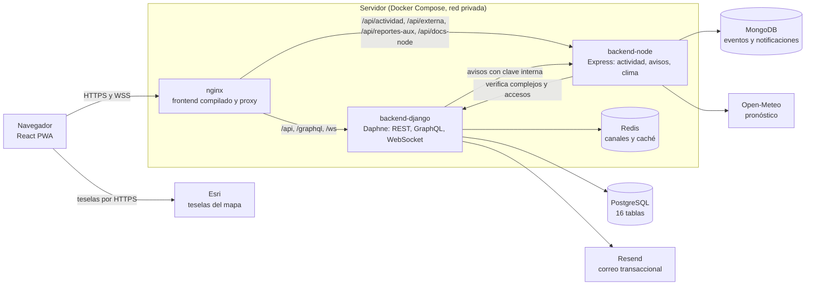
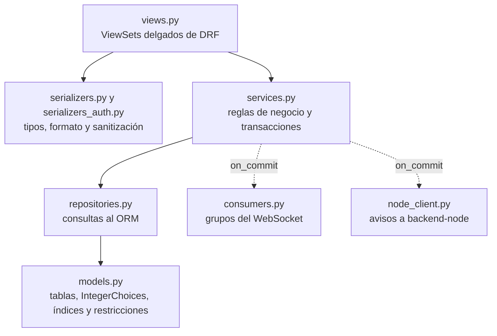
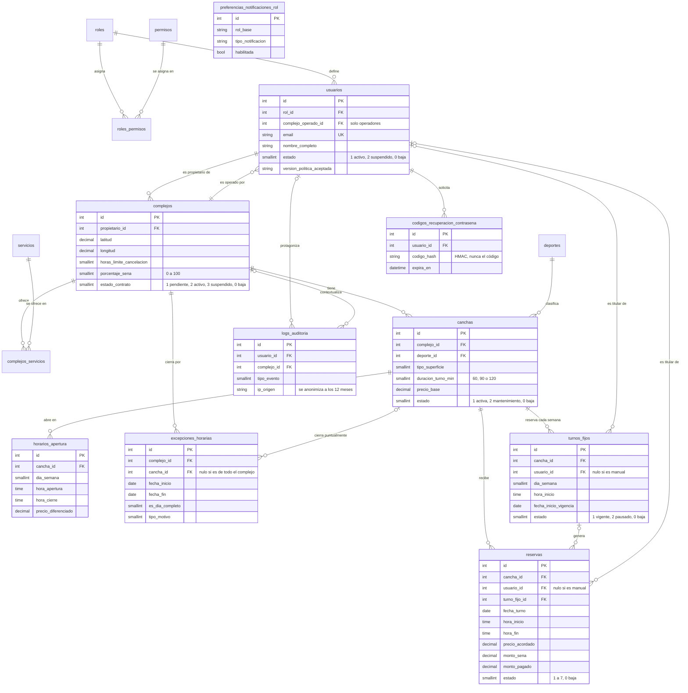
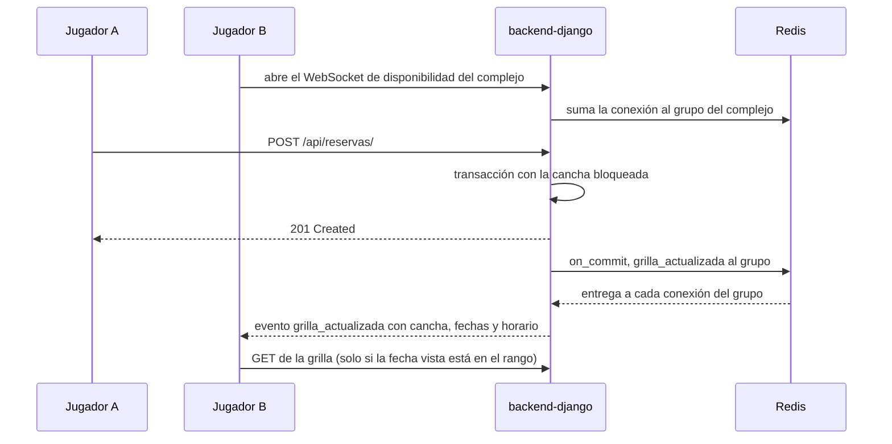

# Arquitectura de TaLibre

Especificación técnica pública del sistema: qué hace cada pieza, cómo se comunican, cómo se guardan los datos, cómo se protegen y por qué se tomó cada decisión. La puesta en marcha está en [INSTALACION.md](INSTALACION.md), los endpoints en [API.md](API.md), el uso por rol en [GUIA_USUARIO.md](GUIA_USUARIO.md) y las pruebas en [COBERTURA.md](COBERTURA.md).

## Índice

1. [Resumen del sistema](#1-resumen-del-sistema)
2. [Vista general](#2-vista-general)
3. [Tecnologías y por qué](#3-tecnologías-y-por-qué)
4. [backend-django](#4-backend-django)
5. [backend-node](#5-backend-node)
6. [Frontend](#6-frontend)
7. [Datos](#7-datos)
8. [Seguridad y datos personales](#8-seguridad-y-datos-personales)
9. [Tiempo real](#9-tiempo-real)
10. [GraphQL frente a REST](#10-graphql-frente-a-rest)
11. [Rendimiento y optimización de consultas](#11-rendimiento-y-optimización-de-consultas)
12. [Pruebas, integración y despliegue continuos](#12-pruebas-integración-y-despliegue-continuos)
13. [Decisiones de arquitectura (ADR)](#13-decisiones-de-arquitectura-adr)

## 1. Resumen del sistema

TaLibre es una plataforma web para reservar turnos en complejos deportivos de Goya, Corrientes. Los jugadores buscan complejos en un catálogo con mapa, ven la grilla de turnos actualizada en tiempo real, reservan, informan la transferencia de la seña y cancelan. Los complejos configuran canchas, horarios y precios, cargan reservas telefónicas y turnos fijos, cierran franjas por mantenimiento o clima y consultan reportes de ocupación y recaudación. La plataforma administra los contratos de los complejos, los usuarios, los roles y la auditoría.

### 1.1. Actores

| Rol | Qué hace |
|---|---|
| Jugador | Busca complejos, reserva, cancela dentro del margen del complejo, informa transferencias, recibe avisos y gestiona su cuenta |
| Operador de complejo | Opera la agenda diaria de un complejo: reservas manuales, turnos fijos, excepciones horarias, cobros y transferencias |
| Dueño de complejo | Todo lo del operador, más la configuración comercial, canchas, horarios, precios, operadores y reportes de sus complejos |
| Superadministrador | Actúa sobre cualquier complejo con los permisos del dueño, y además administra contratos, usuarios, roles, catálogos, preferencias de avisos y auditoría |

Además de los cuatro roles base, el superadministrador puede crear roles personalizados con un subconjunto de los permisos de complejo.

### 1.2. Alcance

Dentro del alcance: catálogo público con filtros y mapa, ficha del complejo con clima, grilla en tiempo real, reservas web y manuales con control de solapamiento, turnos fijos, excepciones horarias, señas por transferencia con su conciliación, cancelación con margen horario, reportes por rango de fechas, notificaciones por rol, recuperación de contraseña por código, consentimiento y baja de cuenta conforme a la Ley 25.326, documentación interactiva de ambas APIs y aplicación instalable.

Fuera del alcance: pasarelas de pago en línea (las señas se transfieren por fuera y el complejo las concilia), torneos, búsqueda de jugadores, stock de cantina, reseñas y puntuaciones, inicio de sesión con cuentas de terceros ([ADR-06](#adr-06-sin-oauth-de-terceros-y-recuperación-por-código)), presencia de usuarios en tiempo real ([ADR-04](#adr-04-websocket-de-lectura-pública-con-identificación-opcional)) y un servicio de inteligencia artificial ([ADR-10](#adr-10-sin-microservicio-de-inteligencia-artificial)).

## 2. Vista general

- **Un solo origen.** El navegador habla con un único dominio. nginx sirve el frontend compilado y reparte las rutas entre los backends, así que no hace falta CORS entre el frontend y las APIs en producción y la cookie de sesión puede ser `SameSite=Strict`.
- **Rutas internas cerradas.** Las rutas `/api/interno` de Node solo las usa Django por la red privada. nginx responde 404 a cualquier pedido externo a ellas, y además exigen una clave compartida.
- **Cada backend con su base.** Django es el único que lee y escribe PostgreSQL. Node es el único que lee y escribe MongoDB. Cuando uno necesita un dato del otro lo pide por HTTP ([ADR-01](#adr-01-dos-backends-y-persistencia-políglota)).
- **El mapa no pasa por los backends.** El navegador descarga las teselas directamente del proveedor, por HTTPS y sin clave de API ([ADR-08](#adr-08-leaflet-directo-sin-react-leaflet-y-teselas-sin-clave)).

## 3. Tecnologías y por qué

| Tecnología | Para qué | Por qué | Qué se pierde sin ella |
|---|---|---|---|
| Django 6.1 y Django REST Framework | API principal, ORM, migraciones, autenticación, permisos | ORM con transacciones y bloqueos de fila, validación declarativa y un ecosistema maduro de seguridad | El núcleo transaccional y las reglas de negocio |
| SimpleJWT | Emisión, rotación y lista negra de tokens | Estándar en DRF, con rotación de refresh y lista negra integradas | La sesión sin estado compartida con Node |
| Django Channels, Daphne y channels-redis | WebSocket de la grilla en tiempo real | Integra el tiempo real con el mismo proceso, modelos y permisos que la API ([ADR-03](#adr-03-tiempo-real-con-django-channels-y-redis)) | Las grillas abiertas dejan de actualizarse solas |
| graphene-django | GraphQL | Se monta sobre los mismos ViewSets de REST, sin duplicar reglas | La consulta única de la ficha con clima |
| drf-spectacular | OpenAPI 3 y Swagger UI de Django | Genera OpenAPI 3 desde los serializers ([ADR-09](#adr-09-drf-spectacular-para-openapi-3)) | La documentación navegable de la API principal |
| nh3 | Sanitización de texto contra XSS | Implementación en Rust de un limpiador de HTML, rápida y mantenida | La defensa en profundidad de los textos libres |
| PostgreSQL | Base principal | Bloqueos de fila reales (`select_for_update`), restricciones parciales e integridad referencial | La garantía contra reservas duplicadas bajo concurrencia |
| Node.js 24 y Express 5 | Servicio de actividad, notificaciones y clima | Liviano para E/S, con su propia base y su propio ciclo de vida | Las bandejas de avisos, las métricas de visitas y el clima |
| Mongoose 9 y MongoDB | Persistencia de eventos y notificaciones | Documentos de escritura frecuente y estructura flexible (`metadata`), sin migraciones | El historial de actividad y los avisos |
| Helmet, express-rate-limit, express-validator | Cabeceras, limitadores y validación en Node | Bibliotecas estándar de Express para cada capa | Defensa contra abuso y entradas inválidas |
| swagger-ui-express | Swagger UI de Node | Sirve la especificación OpenAPI escrita a mano junto al servicio | La documentación navegable de Node |
| Redis | Capa de canales y caché compartida | Grupos por complejo entre procesos y límites coherentes | Con varios procesos, eventos y límites dejan de compartirse |
| React 19 y Vite 8 | Interfaz y compilación | Componentes reutilizables y compilación rápida con división de código | La interfaz |
| Bootstrap 5.3 y react-bootstrap | Grilla de diseño, componentes accesibles y modales | Componentes con accesibilidad resuelta, tematizados con variables propias | Consistencia visual y accesibilidad de base |
| Leaflet | Mapa del catálogo | Licencia BSD-2-Clause, usado con un envoltorio propio ([ADR-08](#adr-08-leaflet-directo-sin-react-leaflet-y-teselas-sin-clave)) | El mapa interactivo |
| Axios | Clientes HTTP del frontend | Interceptores para el token y la renovación de la sesión | La renovación transparente de la sesión |
| nginx | Servidor web y proxy | Sirve estáticos con caché, termina TLS y reparte rutas por prefijo | El origen único |
| Docker Compose | Empaquetado y orquestación | El mismo stack en local, en CI y en producción ([ADR-11](#adr-11-servidor-propio-con-docker-compose-y-despliegue-continuo)) | La reproducibilidad |
| GitHub Actions | Integración y despliegue continuos | Integrado al repositorio y a la protección de `main` | La verificación automática de cada cambio |
| pytest, Jest, Supertest y Vitest | Pruebas | Estándar de cada ecosistema | La red de seguridad para cambiar código |

Las versiones exactas están fijadas en `backend-django/requirements.txt` y en los `package-lock.json`. Todas las dependencias tienen licencias permisivas (MIT, BSD, ISC, Apache-2.0 o PSF), con la única excepción documentada del driver `psycopg2-binary` (LGPL-3.0), usado sin modificar como biblioteca enlazada.

## 4. backend-django

### 4.1. Responsabilidades

- **Núcleo transaccional:** complejos, canchas, horarios, excepciones, reservas, turnos fijos, señas y cobros.
- **Identidad y acceso:** registro con consentimiento, inicio de sesión, emisión de JWT, recuperación de contraseña y RBAC con permisos en base ([ADR-07](#adr-07-rbac-con-permisos-en-base-y-roles-personalizados)).
- **Grilla y reservas atómicas:** cálculo de disponibilidad y motor de reservas que rechaza solapamientos con 409.
- **Reportes:** recaudación, conteos por estado, ocupación por cancha y horarios más pedidos por rango de fechas.
- **GraphQL y tiempo real:** el endpoint `/graphql/` y el WebSocket de disponibilidad.
- **Auditoría:** eventos críticos en la tabla `logs_auditoria` y en un archivo de bitácora de seguridad.

### 4.2. Capas

| Capa | Archivo | Qué contiene |
|---|---|---|
| Modelos | `core/models.py` | Las 16 tablas sobre `ModeloBase` (estado, fecha de creación y de modificación), los estados como `IntegerChoices`, índices compuestos y restricciones de base |
| Repositorios | `core/repositories.py` | Toda consulta al ORM: filtros por estado activo, `select_related`, `prefetch_related`, `select_for_update` y agregaciones de reportes |
| Servicios | `core/services.py` | Reglas de negocio puras: disponibilidad, motor de reservas, conflictos de operatoria, baja de cuenta, reportes, avisos y difusión a la grilla |
| Serializers | `core/serializers.py`, `core/serializers_auth.py` | Validación de tipos y formato, campos declarados uno por uno y limpieza de todo texto con `nh3` |
| Vistas | `core/views.py` | Reciben la request, llaman al servicio y devuelven la respuesta |
| Integraciones | `core/node_client.py`, `core/email_service.py` | Única vía hacia `backend-node` y único despacho de correo |

### 4.3. Transacciones y efectos posteriores

Toda operación que escribe más de una fila corre dentro de `transaction.atomic()`. Los efectos que salen del proceso (el evento del WebSocket, el aviso a Node, el correo) se programan con `transaction.on_commit` y nunca dentro del bloque atómico: si la transacción se revierte, nadie recibe un anuncio de algo que no existe. Una falla de esos efectos se registra en el log y no revierte la operación ya confirmada.

El motor de reservas bloquea la fila de la cancha con `select_for_update` antes de validar, así las altas que compiten por la misma cancha se serializan y las de otras canchas no esperan. Una restricción parcial única de la base (una sola reserva activa por cancha, fecha y hora) queda como última defensa y su error se traduce a 409. Las operaciones que bloquean cancha y turno fijo lo hacen siempre en ese orden, para evitar bloqueos mutuos.

## 5. backend-node

### 5.1. Responsabilidades

- **Actividad del complejo:** registra visitas a la ficha y consultas de la grilla, y las resume en un reporte de visitas por día.
- **Notificaciones:** bandeja personal de cada usuario, registro del complejo y marcado como leído. Los avisos los emite Django por una ruta interna después de confirmar cada operación.
- **Clima:** consulta el pronóstico de Open-Meteo para las coordenadas de un complejo, con caché por complejo.
- **Documentación:** Swagger UI y especificación OpenAPI de sus rutas públicas.
- **Estado interno:** métricas de salud que Django consulta para el reporte de estado del servidor.

### 5.2. Capas

`routes/` → `middlewares/` (`auth`, `rol`, `rateLimit`, `validarCampos`, `servicioInterno`) → `controllers/*.controller.js` → `services/` y `models/`. Las funciones auxiliares sin estado (paginación, fechas, caché temporal) viven en `utils/`. `app.js` arma la aplicación y `server.js` la conecta a MongoDB y la pone a escuchar, así las pruebas usan la aplicación sin abrir puertos ni bases.

### 5.3. Validación del JWT de Django

Node no tiene usuarios ni contraseñas. Valida el access que emite Django con la misma clave de firma, el algoritmo HS256 fijo y solo tokens de tipo access. Toma del token el id y el rol de la cuenta ([ADR-02](#adr-02-django-como-emisor-único-del-jwt)). Para las rutas de panel, además confirma con Django, reenviando el token del usuario, que esa cuenta administra el complejo pedido.

### 5.4. Comunicación en los dos sentidos

| Sentido | Para qué | Cómo |
|---|---|---|
| Node → Django | Verificar que un complejo exista y sea público, y que el usuario lo administre | HTTP con tiempo máximo y sin seguir redirecciones. Cualquier falla se traduce en un 502 genérico, con la causa solo en el log |
| Django → Node | Entregar avisos, entradas del registro y el evento de reserva realizada, y consultar el estado interno | Ruta interna con clave compartida en un encabezado, comparada en tiempo constante. Un único intento con tiempo máximo. Si Node no responde, el aviso queda en el log de Django para reenviarlo y la operación no se revierte |

Ninguno de los dos escribe en la base del otro.

## 6. Frontend

### 6.1. Capas

| Carpeta | Contenido |
|---|---|
| `pages/` | Contenedores de cada pantalla: juntan hooks, servicios y estado, y componen componentes. No definen piezas de interfaz propias |
| `components/` | Toda pieza de interfaz: tarjetas, formularios, campos, barras de filtros, secciones, paginador, estados vacíos y de error. Reciben datos y callbacks por props |
| `hooks/` | Lógica reutilizable con estado: consultas con cancelación (`useConsulta`), disponibilidad en vivo, clima, tema, notificaciones |
| `services/` | Únicos módulos que hablan con los backends, a través de las dos instancias de Axios de `services/api.js` y del cliente WebSocket |
| `config/`, `i18n/`, `styles/`, `utils/` | Parámetros y catálogos, todos los textos de interfaz, los tokens de color del tema y los formatos de fecha y moneda |

Las rutas de los paneles y el mapa se cargan con `React.lazy`, y Leaflet y React van en bloques de compilación propios, así la portada descarga solo lo que necesita.

### 6.2. Sesión

El access vive solo en memoria, dentro de `authService.js`. El refresh viaja en una cookie `HttpOnly`, `Secure` y `SameSite=Strict` con ruta restringida, que JavaScript no puede leer. Al cargar la aplicación se pide un access nuevo con esa cookie. Ante un 401, el interceptor de Axios renueva el access una sola vez, compartiendo la misma promesa entre las peticiones que fallaron a la vez, y reintenta. Nada de la sesión se guarda en `localStorage` ([ADR-05](#adr-05-access-en-memoria-y-refresh-en-cookie-httponly)).

### 6.3. Aplicación instalable

`manifest.json`, íconos propios generados por un script del repositorio y un service worker escrito a mano ([ADR-12](#adr-12-pwa-con-service-worker-propio)). El service worker guarda la cáscara de la aplicación y los recursos estáticos con hash, y nunca toca `/api`, `/ws`, peticiones autenticadas ni otros orígenes.

### 6.4. Tema, textos y accesibilidad

- **Tema claro y oscuro:** se guarda en `data-bs-theme` del documento y respeta la preferencia del sistema. Todos los colores son tokens de `styles/tema.css` declarados para los dos modos con contraste WCAG AA.
- **Textos:** todos viven en `i18n/es.js` y se resuelven con `t(clave, params)`.
- **Fechas:** siempre se muestran como `dd/mm/aaaa` y viajan como `AAAA-MM-DD`, interpretadas por partes para no correrse un día por el huso horario.
- **Grilla:** cinco estados de casillero diferenciados por fondo, borde y tipografía, no solo por color.
- **Accesibilidad:** áreas táctiles de al menos 44 px en las vistas públicas y de jugador, números con cifras tabulares, botones que evitan el doble envío y un indicador de carga único.
- **Seguridad de la interfaz:** los datos de la API se muestran siempre con JSX normal, sin inyectar HTML.

## 7. Datos

### 7.1. PostgreSQL: las 16 tablas

Las tablas `roles`, `permisos`, `roles_permisos`, `servicios`, `complejos_servicios`, `deportes` y `preferencias_notificaciones_rol` son catálogos y relaciones de configuración. Todas las tablas comparten las columnas de `ModeloBase`: `estado`, `fecha_creacion` y `fecha_modificacion`.

### 7.2. Reglas del modelo

- **Borrado lógico universal:** ninguna fila de negocio se borra. Dar de baja es asignar `estado = 0`, y todo listado activo filtra por los estados vigentes. Así las reservas, los reportes y la auditoría nunca pierden sus referencias. Las claves foráneas usan `PROTECT`.
- **Estados numéricos:** estados, superficies, coberturas, iluminación, motivos y tipos de evento son `SMALLINT` con `IntegerChoices`, nunca textos ni booleanos. Agregar un valor no rompe los existentes y el filtro por índice es barato.
- **Montos congelados:** el precio, la seña y lo pagado se fijan al reservar, con `Decimal` y redondeo al centavo. Un cambio de tarifa posterior no reescribe acuerdos hechos. El estado de pago se deduce de los montos y no se guarda, para que dos columnas no puedan contradecirse.
- **Restricciones en la base:** horas de fin posteriores a las de inicio, precios y porcentajes en rango, montos entre cero y el precio acordado, alias obligatorio si el complejo exige seña, nombre de cancha único entre las vigentes y una sola reserva activa por cancha, fecha y hora.
- **Índices compuestos** pensados para cada consulta frecuente: `(cancha, fecha_turno, estado)` y `(usuario, estado, fecha_turno)` en reservas, `(cancha, dia_semana, estado)` en horarios y turnos fijos, `(estado, estado_contrato)` en complejos, `(complejo, estado)` en canchas y `(tipo_evento, fecha_creacion)` en auditoría, entre otros.

### 7.3. MongoDB: las 2 colecciones

| Colección | Campos principales | Uso |
|---|---|---|
| `eventos` | `tipo_evento` (1 complejo visto, 2 grilla consultada, 3 reserva realizada), `complejo_id`, `usuario_id` opcional, `metadata` acotada | Métricas de actividad y reporte de visitas |
| `notificaciones` | `evento` (referencia a `eventos`), `complejo_id`, `usuario_id`, `categoria`, `prioridad`, `mensaje` sin datos personales, `clave_unica` opcional, `ambito`, `estado` (1 no leída, 2 leída, 0 baja) | Bandeja personal y registro del complejo |

Las dos colecciones usan marcas de tiempo con los mismos nombres que Django y baja lógica con `estado = 0`. `clave_unica` tiene un índice único parcial por usuario, así un aviso repetido (por ejemplo, un recordatorio) se descarta. Los ids de usuario son seudónimos: solo identifican a una persona junto con la tabla `usuarios`, y cuando el titular se da de baja esa fila queda anonimizada sin reescribir los documentos.

## 8. Seguridad y datos personales

### 8.1. Autenticación y sesión

- **Tokens:** JWT firmado con HS256. El access dura 30 minutos por defecto y el refresh un día. Cada renovación rota el refresh y pone el anterior en lista negra. El cierre de sesión es idempotente.
- **Contraseñas:** se guardan con el hasher por defecto de Django (PBKDF2 con SHA-256 y un factor de trabajo alto), con validadores de largo, similitud y contraseñas comunes.
- **Recuperación:** código numérico de 6 dígitos generado con `secrets`, vigente 15 minutos, de un solo uso y con tope de intentos. Solo se guarda su HMAC atado a la cuenta, y la respuesta es la misma exista o no la cuenta, para no revelar qué correos están registrados.

### 8.2. Autorización

RBAC con permisos guardados en la base y asignados a roles. El superadministrador hereda todo lo de los roles de complejo. El acceso se controla en dos capas:

- **Visibilidad:** cada consulta devuelve solo lo que el usuario puede ver, así un recurso ajeno responde 404 sin confirmar que existe.
- **Operación:** las clases de permiso responden 403 cuando se ve el recurso pero falta el permiso.

Los serializers de entrada declaran solo los campos que el cliente puede enviar. Precio, estado, autor y hora de fin de una reserva los fija el servidor, lo que evita la asignación masiva.

### 8.3. Defensa de las entradas y del transporte

- **Limitadores:** intentos de inicio de sesión, registro, recuperación de contraseña, altas de reserva, avisos de transferencia, grilla y GraphQL tienen su propio límite. En Node hay un limitador global, uno más estricto para el registro de actividad y otro para las rutas internas. Los 429 se auditan y agrupan en una alerta.
- **XSS:** todo texto libre pasa por `nh3` sin etiquetas permitidas, y el frontend nunca inyecta HTML.
- **Inyección NoSQL:** `sanitizeFilter` global de Mongoose, `metadata` sin claves con `$` ni `.`, parámetros repetidos rechazados y validación de cada campo con `express-validator`.
- **CORS y orígenes:** listas blancas en los dos backends. El WebSocket valida el `Origin` contra los hosts permitidos (protección contra el secuestro de WebSocket entre sitios).
- **Cabeceras:** nginx fija `nosniff`, `X-Frame-Options`, `Referrer-Policy` y HSTS. Django redirige a HTTPS y marca las cookies como seguras fuera de desarrollo, y `check --deploy` queda sin pendientes (lo verifica una prueba). Helmet cubre Node.
- **IP real detrás del proxy:** nginx reemplaza el encabezado `X-Forwarded-For` en lugar de agregarle valores, y ambos backends confían en un único salto de proxy. Así un cliente no puede falsificar su IP para esquivar los límites.
- **Secretos:** todas las claves se leen del entorno. Las imágenes no contienen secretos y las variables del frontend nunca los llevan, porque llegan al navegador.

### 8.4. Auditoría

Los eventos críticos (inicio de sesión fallido, acceso denegado, cambios de contrato, altas de excepción, cambios de configuración, de preferencias de avisos, de cobros y de contraseña, entre otros) se registran en la tabla `logs_auditoria` y en un archivo de bitácora de seguridad. Identifican al titular por su id y nunca guardan contraseñas, tokens, códigos, emails tipeados, teléfonos ni texto libre.

### 8.5. Ley 25.326 de Protección de Datos Personales

- **Finalidad:** cada dato personal tiene una finalidad declarada y se usa solo para ella.
- **Consentimiento:** el registro exige aceptar los términos y la política de privacidad con una casilla que nunca viene marcada. Se guardan la versión y la fecha, y una versión nueva obliga a aceptarla otra vez.
- **Exposición mínima:** las respuestas públicas y los eventos del WebSocket no llevan datos personales. El contacto de un cliente solo lo ve quien administra ese complejo.
- **Supresión:** la baja propia anonimiza nombre, email, teléfono y contraseña, revoca las sesiones y conserva la fila con `estado = 0`. Si el titular tiene reservas señadas, su contacto se copia solo en esas reservas para que el complejo resuelva la seña, y se borra al resolverse o a los 30 días del turno. La vista previa de la baja se lo informa antes de confirmar.
- **Retención:** las IPs de la auditoría se anonimizan a los 12 meses y los refresh vencidos se eliminan, con tareas programadas idempotentes.
- **Transparencia:** la política de privacidad pública declara responsable, finalidades, datos, destinatarios, proveedores y su ubicación, plazos, derechos y la leyenda de la Agencia de Acceso a la Información Pública.

## 9. Tiempo real

- **Grupos por complejo:** cada conexión se suma al grupo `complejo_{id}`. Reservas, cancelaciones, turnos fijos, excepciones y cambios de horarios o de contrato publican el evento `grilla_actualizada` con la cancha, el rango de fechas y el horario afectado, sin datos personales.
- **Publicación después del commit:** el evento sale con `transaction.on_commit`. Antes de avisar se incrementa la versión de la caché de la grilla de ese complejo, así la recarga que dispara el evento ya ve el dato nuevo.
- **Canal de solo lectura:** el servidor ignora los mensajes del cliente sin decodificarlos. Un complejo sin contrato activo rechaza la conexión en el handshake.
- **Cliente:** `wsService.js` reconecta con espera exponencial y variación aleatoria, y al reconectar vuelve a pedir la grilla por REST, que es la fuente de verdad. Los eventos cercanos se agrupan para no recargar varias veces seguidas.
- **Mantenimiento de la conexión:** Daphne envía pings de protocolo periódicos para que la conexión sobreviva a los límites de inactividad de los proxies intermedios.

## 10. GraphQL frente a REST

`POST /graphql/` expone tres consultas y una mutación:

| Operación | Acceso | Fuentes |
|---|---|---|
| `catalogoComplejos` | Público | PostgreSQL |
| `detalleComplejo(id)` | Público | PostgreSQL (ficha, canchas y servicios) y `backend-node` (clima) |
| `misReservas` | Con sesión | PostgreSQL |
| `crearReserva` | Con sesión | PostgreSQL, con el mismo motor anti-solapamiento que REST |

- **Mismas reglas que REST:** los resolvers ejecutan los mismos ViewSets, serializers y permisos de REST en lugar de reescribirlos. Un complejo sin contrato activo responde igual por las dos vías y las pruebas lo comparan.
- **Qué se gana:** la ficha de un complejo con su clima pide por REST dos llamadas a dos servicios distintos. Por GraphQL es una sola ida y vuelta, y el cliente elige los campos (una tarjeta puede pedir solo nombre, canchas y temperatura).
- **Degradación:** el clima es complementario. Si Node falla o tarda, `clima` llega nulo y la ficha llega completa.
- **Protección:** profundidad de consulta limitada, introspección apagada en producción, interfaz GraphiQL solo en desarrollo y un limitador propio.

## 11. Rendimiento y optimización de consultas

Las optimizaciones se fijan con pruebas que cuentan las consultas SQL (`django_assert_num_queries` y `django_assert_max_num_queries`), así una regresión rompe el CI. No se publican mediciones de tiempos ni planes de ejecución que no se hayan tomado.

| Consulta | Optimización | Evidencia |
|---|---|---|
| Grilla diaria de un complejo | Cantidad fija de consultas sin importar canchas, reservas, turnos fijos ni excepciones. Las ocupaciones se leen con `values()` solo con columnas de horario | `core/tests/test_grilla.py` |
| Recargas de la grilla en ráfaga | Caché por complejo y fecha con invalidación por versión: cada evento incrementa la versión del complejo en `on_commit`, así N grillas abiertas producen un cálculo y N-1 lecturas de caché, sin carreras entre cálculo e invalidación. Las marcas que dependen de la hora se aplican sobre la copia | `core/tests/test_grilla.py` |
| Catálogo público | Un `Prefetch` para servicios, otro para canchas y una subconsulta para el precio mínimo: la cantidad de consultas no crece con los complejos | `core/tests/test_catalogo.py` |
| Marcadores del mapa | Una sola consulta con `precio_desde` como subconsulta, sin cargar canchas ni servicios, con tope de resultados | `core/tests/test_marcadores.py` |
| Agenda, "mis reservas" y turnos fijos | Paginados de a 20 con `select_related`. El filtro de conflictos pasó de recorrer reservas en Python a una anotación SQL con `Exists`, con una prueba de paridad contra la regla original | `core/tests/test_agenda.py`, `core/tests/test_reservas.py`, `core/tests/test_conflictos_operatoria.py` |
| Validación de un alta de reserva | Lee solo la cancha, su día y su fecha con `values()`, dentro de la transacción | `core/tests/test_reservas.py` |
| Reportes | Agregaciones en SQL acotadas a un rango máximo, con cantidad de consultas fija | `core/tests/test_reportes.py` |
| Avisos por preferencias | Una consulta de roles y una lectura de un mapa cacheado por lote de avisos, no por destinatario | `core/tests/test_preferencias_notificaciones.py` |
| Clima | Caché de 15 minutos por complejo en Node: el proveedor recibe a lo sumo un pedido por complejo en ese lapso | `backend-node/src/tests/clima.test.js` |

Además:

- **Índices compuestos** alineados con los filtros de cada repositorio (ver 7.2).
- **Paginación** de 20 elementos en todo listado que pueda crecer, en los dos backends. Ninguna pantalla descarga una colección entera para paginarla en el navegador.
- **Conexiones persistentes** a PostgreSQL con verificación de salud, para no pagar el handshake TLS en cada petición.
- **Frontend:** división de código por ruta, Leaflet en un bloque propio que se descarga solo al abrir el mapa, recursos con hash servidos con caché inmutable de un año, y una petición anterior cancelada cuando cambia un filtro.

## 12. Pruebas, integración y despliegue continuos

- **backend-django:** pytest con pytest-django sobre SQLite en memoria y pruebas de concurrencia reales sobre PostgreSQL. Cubren reglas de negocio, permisos por rol, límites, sanitización, WebSocket, GraphQL, ausencia de datos personales en respuestas y logs, y la configuración de despliegue.
- **backend-node:** Jest y Supertest con MongoDB, Django y Open-Meteo simulados, en orden aleatorio, con un umbral de cobertura del 95 %.
- **frontend:** Vitest para las funciones puras, eslint y la compilación de producción.
- **Punta a punta:** una prueba de humo recorre, a través de nginx y con el stack completo levantado, el camino de un jugador desde la portada hasta reservar, recibir el evento del WebSocket y cancelar.
- **CI:** cada pull request instala, analiza (ruff y eslint), prueba los tres proyectos, corre la concurrencia sobre PostgreSQL, construye las imágenes, levanta el stack local y corre la prueba de humo. `main` solo acepta cambios con el CI en verde.
- **CD:** cada push a `main` con el CI en verde despliega exactamente el commit aprobado. Las versiones se etiquetan y el rollback se hace desde el mismo workflow ([INSTALACION.md](INSTALACION.md#7-despliegue-versiones-y-rollback)).

Los totales y la cobertura por módulo están en [COBERTURA.md](COBERTURA.md).

## 13. Decisiones de arquitectura (ADR)

Cada decisión sigue el formato contexto, decisión, alternativas descartadas y consecuencias.

### ADR-01. Dos backends y persistencia políglota

- **Contexto:** el sistema tiene un núcleo transaccional con reglas estrictas de integridad (reservas que no pueden solaparse, montos, contratos) y datos complementarios de escritura frecuente y estructura variable (eventos de actividad, avisos).
- **Decisión:** Django sobre PostgreSQL concentra el negocio. Node sobre MongoDB guarda actividad y notificaciones e integra servicios externos (clima). Cada uno es dueño exclusivo de su base y se comunican por HTTP.
- **Alternativas descartadas:** un solo backend con una sola base, que mezcla la escritura de alto volumen de eventos con las transacciones de reservas. Dos backends sobre la misma base, que acopla sus esquemas y vuelve ambiguo quién es responsable de cada tabla.
- **Consecuencias:** una caída de Node no afecta reservas ni pagos, solo avisos, métricas y clima. A cambio, hay que mantener un contrato HTTP entre servicios, una clave interna y el manejo de fallas parciales (avisos que quedan en el log, clima nulo).

### ADR-02. Django como emisor único del JWT

- **Contexto:** los dos backends necesitan saber quién hace cada petición y con qué rol.
- **Decisión:** solo Django registra, guarda contraseñas y emite tokens. Node valida el access con la clave compartida y, cuando necesita autorización sobre un complejo, se la pregunta a Django.
- **Alternativas descartadas:** login y hash de contraseñas también en Node, que duplica la superficie de ataque y obliga a sincronizar usuarios entre dos bases. Sesiones con estado consultadas en cada petición, que agregan un salto a Django por cada pedido.
- **Consecuencias:** una sola fuente de verdad de identidad y un solo lugar donde endurecer contraseñas y recuperación. Un access robado vale hasta su vencimiento también en Node, por eso su vida es corta y el refresh rota.

### ADR-03. Tiempo real con Django Channels y Redis

- **Contexto:** la grilla debe reflejar al instante las reservas de otros, y el dato de disponibilidad vive en Django.
- **Decisión:** WebSocket con Django Channels, servido por Daphne, con Redis como capa de canales y grupos por complejo.
- **Alternativas descartadas:** Socket.IO en Node, que obliga a Django a notificar a Node cada cambio y suma un salto y un punto de falla al camino crítico. Firebase u otro servicio administrado, que lleva datos a un tercero y agrega una dependencia con clave en el frontend. Consultas periódicas desde el navegador, que multiplican la carga y llegan tarde.
- **Consecuencias:** el evento se emite en el mismo proceso que confirma la transacción, con `on_commit`, sin carreras. Con varios procesos hace falta Redis. Sin él, el canal queda en memoria y solo sirve para desarrollo.

### ADR-04. WebSocket de lectura pública con identificación opcional

- **Contexto:** el catálogo y la grilla son públicos por negocio: cualquiera puede ver qué turnos están libres antes de registrarse. El patrón habitual de un canal de tiempo real exige autenticación, membresía y suele sumar presencia.
- **Decisión:** el canal acepta conexiones anónimas en modo lectura. Si llega un token válido identifica al usuario, y si es inválido la conexión sigue como anónima. Los eventos no llevan datos personales. Se valida el `Origin`, se ignoran los mensajes del cliente, se rechazan complejos sin contrato activo y se limitan las conexiones por IP. No se implementa presencia.
- **Alternativas descartadas:** exigir sesión para ver la grilla en vivo, que contradice la regla de negocio y empeora la conversión. Presencia de usuarios, que no aporta al caso de uso y expondría quién mira qué complejo.
- **Consecuencias:** un canal sin superficie de escritura ni datos sensibles. Las reglas (anónimo en lectura, token válido identifica, token inválido sigue anónimo, complejo sin contrato rechazado, eventos sin datos personales) están cubiertas por pruebas.

### ADR-05. Access en memoria y refresh en cookie HttpOnly

- **Contexto:** un token guardado en `localStorage` lo puede leer cualquier script que logre ejecutarse en la página.
- **Decisión:** el access vive solo en memoria y el refresh en una cookie `HttpOnly`, `Secure` y `SameSite=Strict` con ruta restringida a las rutas de token, así no viaja en el resto de las peticiones. Al recargar la página la sesión se recupera con la cookie.
- **Alternativas descartadas:** los dos tokens en `localStorage`, expuestos ante un XSS. Sesiones de Django con cookie, que Node no puede validar sin consultar a Django.
- **Consecuencias:** un XSS no puede robar el refresh. `SameSite=Strict` exige que el frontend y la API compartan sitio, lo que el despliegue resuelve con un solo origen detrás de nginx. En desarrollo se usa siempre `localhost`.

### ADR-06. Sin OAuth de terceros y recuperación por código

- **Contexto:** se necesita una forma de recuperar el acceso sin soporte humano, y el inicio de sesión con Google u otros proveedores comparte datos con un tercero y suma configuración por entorno.
- **Decisión:** solo email y contraseña. La recuperación usa un código de 6 dígitos enviado por correo, de vida corta, un solo uso y tope de intentos, guardado como HMAC.
- **Alternativas descartadas:** OAuth de terceros, que suma un destinatario de datos personales y una dependencia externa al inicio de sesión. Enlace mágico por correo, que obliga a abrir el correo en el mismo dispositivo y es más fácil de reenviar por error.
- **Consecuencias:** menos proveedores que declarar en la política de privacidad y control completo del flujo. La cuota diaria del proveedor de correo se vigila y, al agotarse, no se generan códigos que nadie recibiría.

### ADR-07. RBAC con permisos en base y roles personalizados

- **Contexto:** los cuatro roles tienen alcances distintos y un complejo puede necesitar personal con permisos intermedios.
- **Decisión:** permisos como filas de la base, asignados a roles, verificados por clases de permiso de DRF. El superadministrador hereda los de los roles de complejo y puede crear roles personalizados con un subconjunto de los permisos de complejo. Los permisos de plataforma no se pueden delegar.
- **Alternativas descartadas:** roles fijos en el código con condiciones por nombre de rol, que obligan a desplegar para cambiar un alcance. Los grupos y permisos del admin de Django, pensados para el panel de administración y no para un modelo de negocio por complejo.
- **Consecuencias:** cambiar qué puede hacer un rol es un dato y no código. La pertenencia al complejo se valida aparte (propietario u operador asignado), así un permiso nunca alcanza complejos ajenos.

### ADR-08. Leaflet directo sin react-leaflet y teselas sin clave

- **Contexto:** el catálogo necesita un mapa interactivo, con licencias abiertas y sin secretos en el navegador.
- **Decisión:** Leaflet (BSD-2-Clause) con un envoltorio propio de React, y teselas de calles de un proveedor que no exige clave de API, con sus atribuciones visibles.
- **Alternativas descartadas:** `react-leaflet`, cuya licencia Hippocratic no es una licencia de código abierto aprobada. Proveedores de teselas que exigen clave, que quedaría expuesta en el navegador. Mapas comerciales con facturación por uso.
- **Consecuencias:** un envoltorio pequeño que mantener. El proveedor de teselas recibe la IP de quien abre el mapa, y por eso figura como destinatario en la política de privacidad.

### ADR-09. drf-spectacular para OpenAPI 3

- **Contexto:** las dos APIs deben tener documentación navegable y actualizada.
- **Decisión:** drf-spectacular genera OpenAPI 3 desde los serializers y vistas de Django, con Swagger UI servido por el propio servidor sin CDN. En Node, una especificación OpenAPI 3 escrita a mano servida con swagger-ui-express. Ninguna de las dos incluye rutas internas ni el panel de administración.
- **Alternativas descartadas:** drf-yasg, que solo genera Swagger 2.0. Recursos de Swagger UI desde un CDN, que suma un tercero que recibe la IP de cada visita.
- **Consecuencias:** la documentación de Django no se desactualiza porque sale del código. La de Node se mantiene a mano y una prueba verifica que sus rutas coincidan con las montadas.

### ADR-10. Sin microservicio de inteligencia artificial

- **Contexto:** se evaluó sumar un servicio de recomendaciones o un asistente conversacional sobre un modelo local.
- **Decisión:** queda fuera del alcance.
- **Alternativas descartadas:** un servicio aparte con un modelo de lenguaje local, que exige memoria y CPU que el servidor no tiene sin degradar el resto. Una API de un proveedor externo, que suma un destinatario de datos personales y un costo por uso.
- **Consecuencias:** el esfuerzo se concentró en la integridad de las reservas, el tiempo real y la protección de datos. La arquitectura en servicios separados permite sumarlo después sin tocar el núcleo.

### ADR-11. Servidor propio con Docker Compose y despliegue continuo

- **Contexto:** el sistema necesita WebSockets de larga duración, Redis, un proxy con reglas propias y HTTPS, y debe estar siempre disponible para demostraciones.
- **Decisión:** un servidor en la nube con Docker Compose (nginx, Django, Node y Redis en una red privada), bases administradas para PostgreSQL y MongoDB, y despliegue continuo con GitHub Actions por SSH después de cada CI verde en `main`.
- **Alternativas descartadas:** plataformas gratuitas de aplicaciones, que suspenden los servicios inactivos, cortan conexiones largas y no permiten un proxy propio con las mismas reglas que el entorno local.
- **Consecuencias:** el mismo `docker compose` corre en local, en CI y en producción. La operación (certificados, tareas programadas, actualizaciones del sistema) queda a cargo del equipo.

### ADR-12. PWA con service worker propio

- **Contexto:** la aplicación debe poder instalarse en el celular y cargar rápido, sin guardar nunca datos personales en el almacenamiento del navegador.
- **Decisión:** manifiesto, íconos generados por un script propio y un service worker escrito a mano que guarda solo la cáscara y los recursos estáticos con hash.
- **Alternativas descartadas:** un plugin que genera el service worker con estrategias por defecto, que suma dependencias y hace más difícil garantizar que nunca se guarde una respuesta de la API.
- **Consecuencias:** control total de qué se guarda, en menos de doscientas líneas. Cambiar la estrategia exige incrementar la versión del caché a mano.

### ADR-13. Imágenes base livianas, multietapa y sin root

- **Contexto:** las imágenes se construyen en cada despliegue y en cada pull request, y corren expuestas a internet.
- **Decisión:**
  - `python:3.14-slim` para Django. Es Debian con glibc, donde las dependencias con extensiones nativas (`psycopg2-binary`, `nh3`) se instalan desde ruedas precompiladas.
  - `node:24-alpine` para Node, cuyas dependencias son JavaScript puro, con solo las dependencias de producción.
  - El frontend en dos etapas: compila con `node:24-alpine` y publica solo el resultado sobre `nginx:1.27-alpine`.
  - En el entorno local, `postgres:16-alpine`, `mongo:7` y `redis:7-alpine`.
  - Los backends corren con un usuario sin privilegios.
  - Las dependencias se instalan en una capa anterior al código.
- **Alternativas descartadas:** Alpine para Django, que con musl obliga a compilar esas extensiones y alarga cada construcción. Imágenes completas, varias veces más pesadas. Correr como root.
- **Consecuencias:** un cambio de código reconstruye solo la última capa y el despliegue tarda segundos. Las imágenes no contienen secretos, herramientas de compilación ni el código fuente del frontend.

### ADR-14. Especificación escrita antes del código

- **Contexto:** dos personas trabajando en tres proyectos, con asistentes de programación, necesitan que cada cambio respete las mismas reglas.
- **Decisión:** desarrollo guiado por especificación. Antes de programar cada etapa se escribieron el modelo de datos, los contratos de la API, la matriz de permisos y las reglas de arquitectura, estilo, seguridad y datos personales. Cada etapa se implementó contra esa especificación, con sus pruebas en el mismo cambio, y la especificación se corrigió cuando la implementación reveló un caso no previsto. Este documento es su versión pública.
- **Alternativas descartadas:** diseñar sobre la marcha, que produce reglas implícitas y contradicciones entre servicios.
- **Consecuencias:** las decisiones quedan escritas con su justificación y las pruebas verifican lo que la especificación promete. Mantener la especificación al día es parte de cada tarea.
