# Guía de usuario

TaLibre es una plataforma para reservar turnos en complejos deportivos de Goya. Esta guía recorre lo que puede hacer cada tipo de usuario, con capturas del sistema funcionando. Todas las personas, complejos, teléfonos y alias que aparecen son datos de demostración inventados.

Para levantar el sistema en una computadora propia y entrar con los usuarios de demostración, ver [INSTALACION.md](INSTALACION.md). La arquitectura y las decisiones técnicas están en [ARQUITECTURA.md](ARQUITECTURA.md).

## Índice

1. [Para quién es](#1-para-quién-es)
2. [Cualquier visitante: catálogo, mapa y ficha](#2-cualquier-visitante-catálogo-mapa-y-ficha)
3. [Jugador: reservar, pagar la seña y cancelar](#3-jugador-reservar-pagar-la-seña-y-cancelar)
4. [Operador: la agenda del día](#4-operador-la-agenda-del-día)
5. [Dueño: configuración, canchas y reportes](#5-dueño-configuración-canchas-y-reportes)
6. [Superadministrador: la plataforma](#6-superadministrador-la-plataforma)
7. [Tiempo real](#7-tiempo-real)
8. [Celular, aplicación instalable y modo oscuro](#8-celular-aplicación-instalable-y-modo-oscuro)
9. [Documentación de las APIs](#9-documentación-de-las-apis)
10. [Cómo está construida la interfaz](#10-cómo-está-construida-la-interfaz)

## 1. Para quién es

| Usuario | Qué resuelve |
|---|---|
| Visitante sin cuenta | Busca complejos, ve sus canchas, servicios, precios, clima y los turnos libres de cada día |
| Jugador | Reserva un turno, informa la transferencia de la seña, cancela dentro del plazo del complejo y recibe avisos |
| Operador de complejo | Atiende la agenda diaria: reservas telefónicas, turnos fijos, cierres puntuales, cobros y transferencias |
| Dueño de complejo | Configura su complejo, canchas, horarios, precios y operadores, y consulta los reportes |
| Superadministrador | Administra los contratos de los complejos, los usuarios, los roles, los catálogos y la auditoría |

La barra superior muestra solo las secciones del rol de cada cuenta: **Inicio**, **Mis reservas**, **Mi complejo**, **Reportes**, **Sistema** y **Mi perfil**, más la campana de notificaciones y el botón de modo claro u oscuro.

## 2. Cualquier visitante: catálogo, mapa y ficha

### 2.1. Catálogo con filtros y mapa

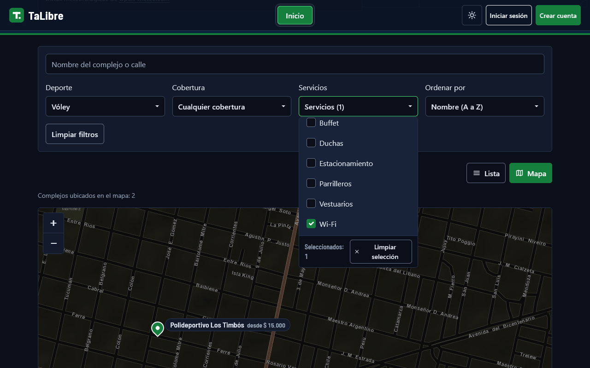

La portada (`/`) es el catálogo de complejos. Para buscar:

1. Escribí el nombre del complejo o de la calle.
2. Filtrá por **Deporte**, **Cobertura** y **Servicios** (se pueden elegir varios) y ordená los resultados.
3. Alterná entre **Lista** y **Mapa**. En el mapa, cada marcador muestra el nombre del complejo y el precio más bajo de sus turnos, y tocarlo abre su ficha.

Los filtros quedan en la dirección de la página, así una búsqueda se puede compartir como enlace. **Limpiar filtros** vuelve al catálogo completo. Solo aparecen los complejos con contrato activo.

### 2.2. Ficha del complejo y clima

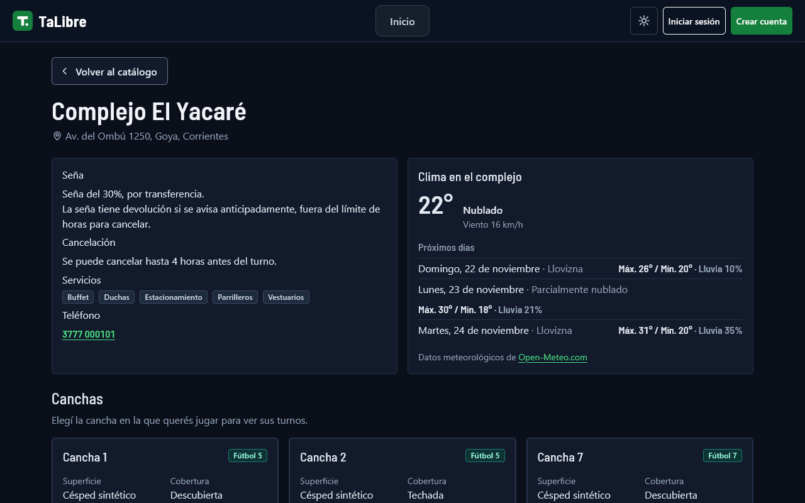

La ficha muestra la dirección, las condiciones de la seña y de cancelación, los servicios, el teléfono, las canchas con su superficie, cobertura, iluminación y precio, y el clima actual con el pronóstico de los próximos días. El clima sale de Open-Meteo.com y su atribución se muestra siempre. Si el pronóstico no está disponible, en su lugar aparece un aviso con **Reintentar** y el resto de la ficha funciona igual.

## 3. Jugador: reservar, pagar la seña y cancelar

### 3.1. Crear la cuenta

En **Crear cuenta** se cargan nombre, email, teléfono opcional y contraseña. Para registrarse hay que marcar la casilla de aceptación de los [Términos y condiciones](#64-términos-condiciones-y-política-de-privacidad) y de la Política de privacidad, que nunca viene marcada. Si después se publica una versión nueva de esos documentos, al ingresar aparece un diálogo para aceptarla antes de seguir.

Quien olvidó su contraseña la recupera desde **Iniciar sesión** con un código de 6 dígitos que llega por correo y vence a los 15 minutos.

### 3.2. Elegir un turno

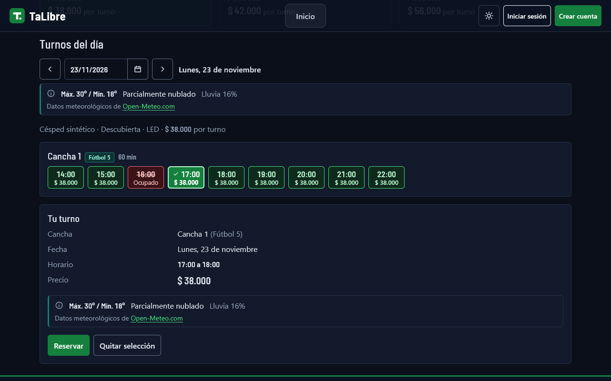

1. En la ficha, elegí la cancha y el día con las flechas o el calendario. Junto a la fecha se ve el pronóstico de ese día.
2. La grilla muestra cada turno con su horario y su precio. Cada estado se distingue por fondo, borde y tipografía, no solo por color:
   - **Libre:** se puede reservar.
   - **Ocupado:** horario tachado, ya lo tomó alguien.
   - **Cerrado:** el complejo cerró esa franja por mantenimiento, clima o feriado.
   - **No disponible:** ya empezó o está fuera del plazo de reserva.
   - **Seleccionado:** marcado con un tilde.
3. **Tu turno** resume la cancha, la fecha, el horario y el precio. **Reservar** confirma (si no hay sesión, pide iniciarla) y **Quitar selección** la descarta.

La grilla se actualiza sola cuando otra persona reserva o cancela (ver [Tiempo real](#7-tiempo-real)). Si dos personas intentan reservar el mismo turno a la vez, solo una lo consigue y la otra recibe un aviso de que el turno ya no está libre.

### 3.3. Mis reservas y la seña

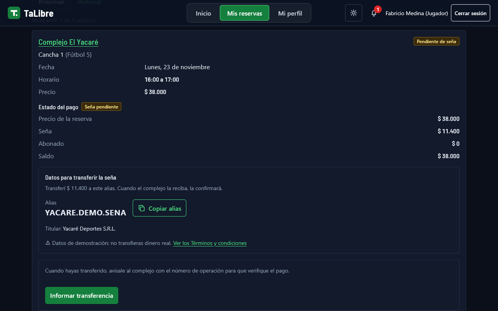

En **Mis reservas** están las próximas y el historial. Cada reserva muestra el complejo, la cancha, la fecha, el horario, el estado y el detalle del pago: precio, seña, lo abonado y el saldo.

Si el complejo pide seña:

1. La reserva queda **Pendiente de seña** y muestra el alias, y si lo hay el CBU o CVU, con el titular de la cuenta. **Copiar alias** lo copia al portapapeles.
2. Después de transferir, **Informar transferencia** permite avisarle al complejo quién transfirió y el número de operación.
3. El complejo verifica el pago y confirma la seña. Si no la encuentra, la rechaza con un motivo y la reserva pide informarla de nuevo.

Los datos de pago de la demostración son ficticios: no se debe transferir dinero real.

### 3.4. Cancelar

Desde **Mis reservas**, una reserva se puede cancelar mientras falten más horas que el límite que fija cada complejo (por ejemplo, 4 horas antes del turno). Pasado ese plazo hay que comunicarse con el complejo.

### 3.5. Notificaciones y perfil

- **Campana:** muestra la cantidad de avisos sin leer. La bandeja tiene arriba los urgentes y permite marcar uno o todos como leídos. El jugador recibe avisos de sus reservas (confirmación de la seña, cancelación por el complejo) y un recordatorio antes del turno.
- **Mi perfil:** editar nombre y teléfono, cambiar la contraseña y dar de baja la cuenta. Antes de confirmar la baja, una vista previa informa qué reservas se cancelarían y cuáles se conservan por tener seña pagada. La baja anonimiza los datos personales.

## 4. Operador: la agenda del día

El operador trabaja sobre un único complejo desde **Mi complejo**, con las pestañas **Configuración** (solo lectura para él), **Canchas y horarios**, **Excepciones**, **Agenda** y **Registro**.

### 4.1. Agenda

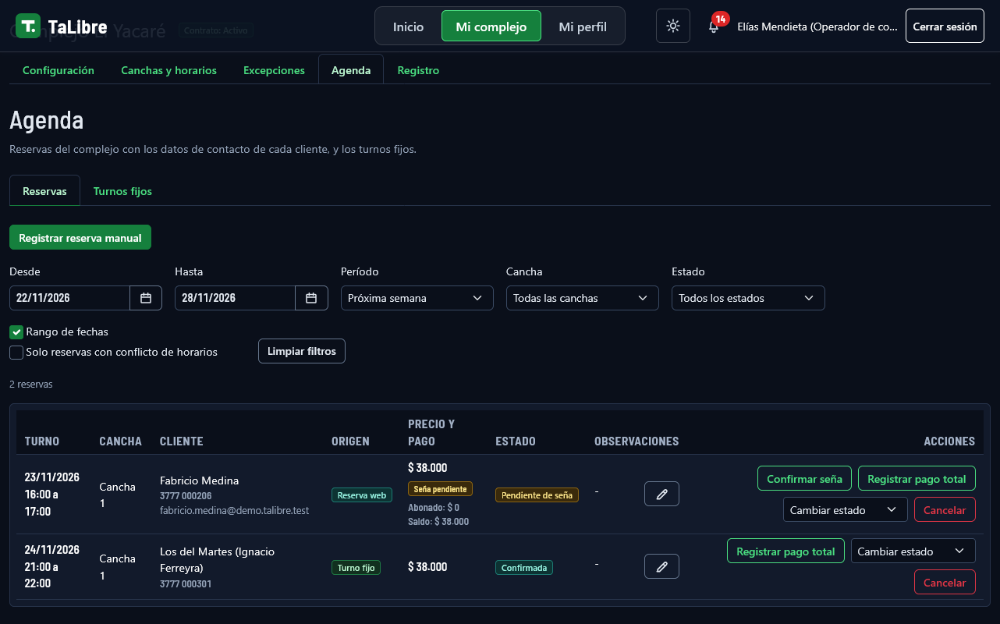

La agenda lista las reservas del complejo con el contacto de cada cliente, el origen (reserva web, manual o turno fijo), el precio y el estado del pago. Se filtra por rango de fechas o período, cancha, estado y reservas con conflicto de horarios.

Acciones de cada reserva:

- **Confirmar seña** y **Registrar pago total:** registran lo cobrado.
- **Rechazar transferencia:** devuelve al jugador una transferencia informada que no llegó, con un motivo.
- **Cambiar estado:** confirmada, completada o ausente.
- **Cancelar:** cancela la reserva sin límite horario y le avisa al jugador.
- **Reabrir:** corrige una cancelación hecha por error, si el turno sigue libre.
- **Observaciones:** notas internas que el jugador no ve.

### 4.2. Reservas manuales y turnos fijos

- **Registrar reserva manual:** carga una reserva telefónica o presencial con el nombre y el teléfono del cliente. Pasa por el mismo control de solapamiento que una reserva web.
- **Turnos fijos:** reservan la misma cancha, el mismo día y horario cada semana. Se pueden pausar, reanudar, cambiar de horario y dar de baja. Si una excepción cae sobre una fecha de un turno fijo, esa fecha queda en espera hasta que el complejo decida mantenerla o cancelarla.

### 4.3. Excepciones horarias

En **Excepciones** se cierra todo el complejo o una cancha por un día completo o una franja horaria, con un motivo (mantenimiento, condiciones climáticas, feriado, evento privado, corte de servicio u otro). La grilla muestra esos turnos como cerrados al instante.

## 5. Dueño: configuración, canchas y reportes

### 5.1. Configuración del complejo

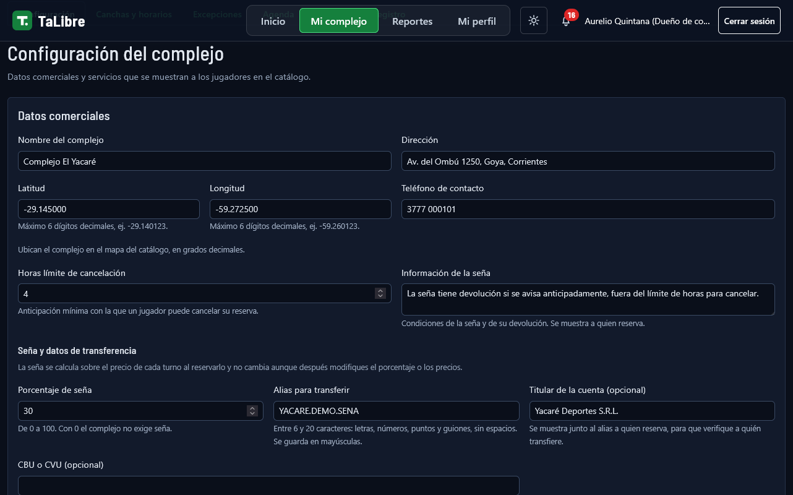

En **Mi complejo > Configuración** el dueño edita:

- **Datos comerciales:** nombre, dirección, ubicación en el mapa, teléfono y horas límite de cancelación.
- **Seña y datos de transferencia:** porcentaje de seña (0 si no se exige), alias, titular y CBU o CVU. La seña se calcula al reservar y no cambia aunque después se modifiquen el porcentaje o los precios.
- **Servicios:** los que el complejo ofrece y aparecen en el catálogo.
- **Operadores:** alta y baja de las cuentas que atienden la agenda.

### 5.2. Canchas y horarios

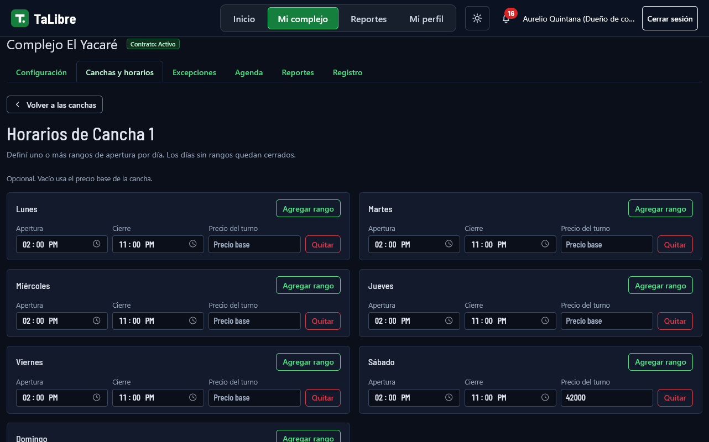

En **Canchas y horarios** se crean las canchas con su deporte, superficie, cobertura, iluminación, duración del turno (60, 90 o 120 minutos) y precio base. Cada cancha tiene sus horarios por día de la semana:

- Un día puede tener uno o más rangos de apertura, por ejemplo de mañana y de tarde.
- Cada rango puede tener un precio propio. Si se deja vacío usa el precio base.
- Un día sin rangos queda cerrado.

Si un cambio de horario, de duración o pasar una cancha a mantenimiento deja reservas futuras fuera de horario, el sistema muestra cuáles son y pide confirmar. Las reservas afectadas quedan marcadas en la agenda para resolverlas.

### 5.3. Reportes

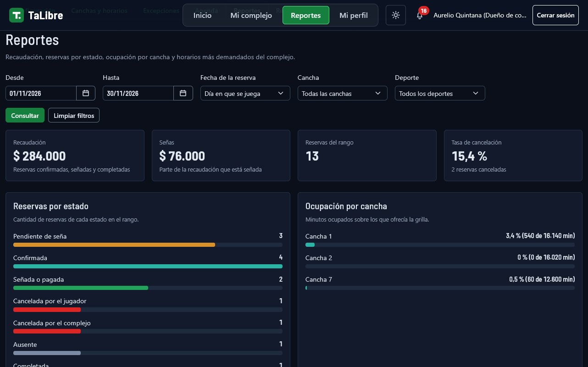

En **Reportes** se elige un rango de fechas, qué fecha de la reserva se compara con ese rango (el día en que se juega, el día en que se hizo o su última modificación) y, si se quiere, una cancha o un deporte. El reporte muestra:

- **Recaudación:** reservas confirmadas, señadas y completadas, y la parte señada.
- **Reservas por estado** y tasa de cancelación.
- **Ocupación por cancha:** minutos ocupados sobre los que ofrecía la grilla.
- **Horarios más demandados.**

Un rango sin reservas muestra ceros. El **Registro** del complejo guarda el historial de lo ocurrido (reservas, cancelaciones, cambios de configuración) para dueño y operador.

## 6. Superadministrador: la plataforma

El superadministrador tiene todo lo del dueño sobre cualquier complejo y la sección **Sistema**, con las pestañas **Usuarios**, **Roles**, **Contratos**, **Deportes**, **Servicios**, **Notificaciones** y **Auditoría**.

### 6.1. Contratos

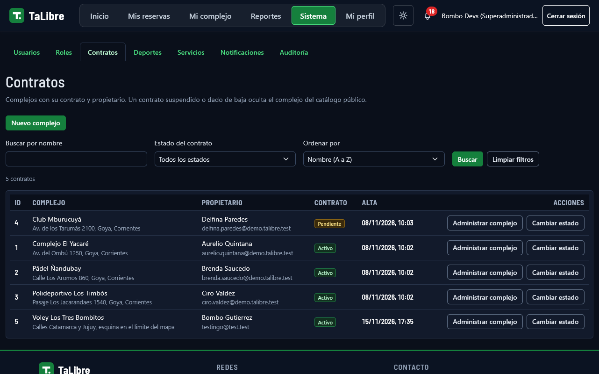

**Contratos** lista los complejos con su propietario, el estado del contrato y la fecha de alta. Desde acá se da de alta un complejo nuevo, se entra a administrarlo y se cambia el estado del contrato. Un contrato **Suspendido** o dado de baja oculta el complejo del catálogo y de la grilla pública en el momento. Con el contrato suspendido el dueño y sus operadores siguen viendo el complejo en su panel. Con el contrato dado de baja deja de aparecerles hasta que el contrato pase a otro estado, por ejemplo de nuevo a **Pendiente** o **Activo**.

### 6.2. Usuarios, roles, catálogos y notificaciones

- **Usuarios:** buscar cuentas, cambiar su rol, suspenderlas o darlas de baja.
- **Roles:** crear roles personalizados con un subconjunto de los permisos de complejo. Los cuatro roles base son de solo lectura.
- **Deportes y Servicios:** los catálogos que usan las canchas y los filtros.
- **Notificaciones:** activar o desactivar cada categoría de aviso para cada rol. Los correos de seguridad, como el código de recuperación, no se pueden apagar.

### 6.3. Auditoría

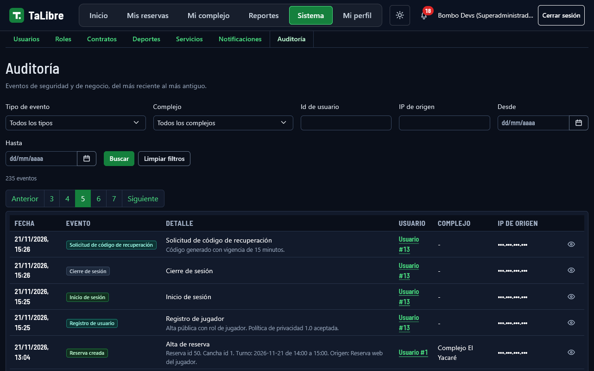

**Auditoría** muestra los eventos de seguridad y de negocio del más reciente al más antiguo: inicios y cierres de sesión, intentos fallidos, registros, reservas, cambios de contrato, de configuración y de contraseña. Se filtra por tipo, complejo, usuario, IP y fechas. Cada evento identifica a la cuenta por su número y nunca guarda contraseñas, códigos ni textos escritos por los usuarios. La IP se muestra oculta y el ícono del ojo la revela solo en esa fila.

### 6.4. Términos, condiciones y política de privacidad

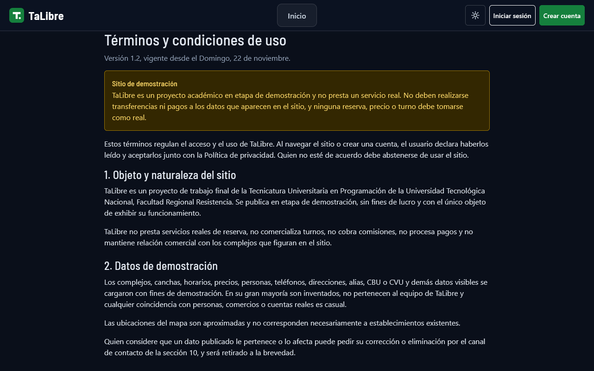

Los **Términos y condiciones** (`/terminos`) y la **Política de privacidad** (`/privacidad`) son públicos y se enlazan desde el pie de cada página. Comparten número de versión. Los términos aclaran que el sitio es una demostración y que no deben hacerse pagos reales. La política declara qué datos se tratan, para qué, quién los recibe, cuánto tiempo se conservan y cómo ejercer los derechos de acceso, rectificación y supresión.

## 7. Tiempo real

Para verlo funcionar hacen falta dos pantallas, por ejemplo una computadora y un celular, o dos ventanas del navegador:

1. En las dos, abrí la ficha del mismo complejo y elegí la misma cancha y el mismo día.
2. En la primera, iniciá sesión como jugador y reservá un turno libre.
3. En la segunda, sin recargar, el turno pasa a **Ocupado** en uno o dos segundos.
4. Cancelá la reserva desde **Mis reservas** en la primera pantalla y el turno vuelve a **Libre** en la segunda.

Lo mismo ocurre cuando el complejo carga una reserva manual, cierra una franja o cambia sus horarios. La grilla se ve en vivo sin necesidad de iniciar sesión. Si la conexión se corta, se recupera sola y vuelve a pedir la grilla para no perder ningún cambio.

## 8. Celular, aplicación instalable y modo oscuro

| Android | iPhone |
|---|---|
| 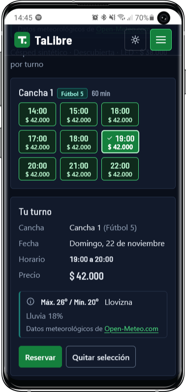 | 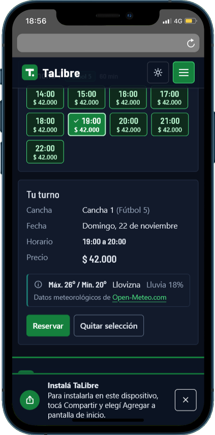 |

Las dos capturas muestran la grilla de un día en modo oscuro con un turno seleccionado y su resumen. En la del iPhone aparece abajo el aviso para instalar la aplicación.

- **Celular:** las vistas públicas y del jugador están pensadas primero para el celular, con botones y casilleros de al menos 44 píxeles. En pantallas chicas el menú se abre con el botón de la derecha.
- **Aplicación instalable:** en el celular, el navegador ofrece instalar TaLibre en la pantalla de inicio. En iPhone, un aviso explica cómo hacerlo desde **Compartir > Agregar a pantalla de inicio**. Instalada, abre a pantalla completa y carga más rápido.
- **Modo claro y oscuro:** el botón del sol o la luna de la barra superior alterna entre los dos. Sin elección, se usa el modo del sistema, y la elección se recuerda en ese navegador.

## 9. Documentación de las APIs

Las dos APIs publican su documentación interactiva con Swagger UI, con los endpoints agrupados por tema, sus parámetros, sus respuestas y un botón **Authorize** para probar las rutas privadas con un token.

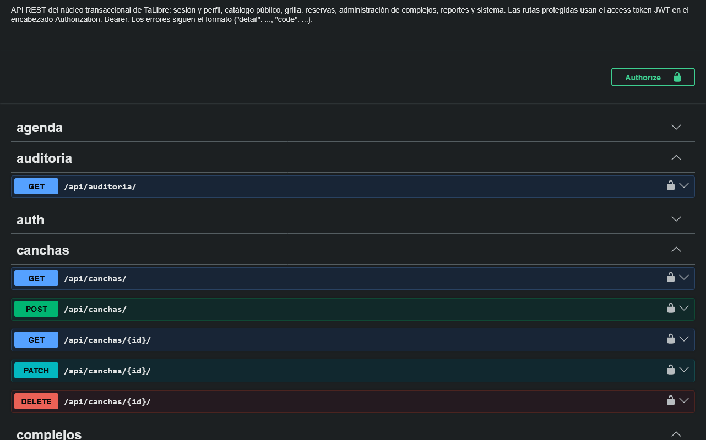

- **API principal (Django):** `/api/docs-django/`, con su especificación OpenAPI en `/api/docs-django/openapi.json`.

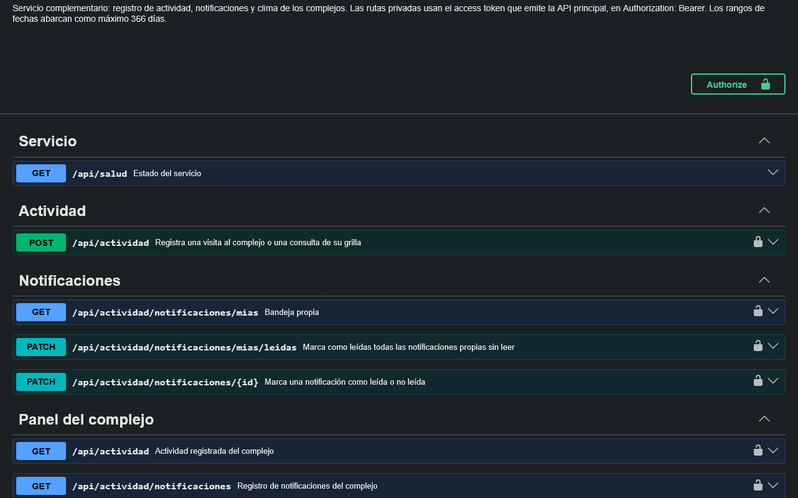

- **Servicio complementario (Node):** `/api/docs-node/`, con actividad, notificaciones, reportes de visitas y clima.

La referencia escrita, con los roles mínimos y los códigos de respuesta de cada endpoint, está en [API.md](API.md).

## 10. Cómo está construida la interfaz

La interfaz es una aplicación de React compilada con Vite. Sus reglas de organización:

- **Páginas cortas, componentes reutilizables:** cada pantalla de `pages/` solo junta datos, estado y navegación, y se arma con componentes de `components/` (tarjetas, formularios, campos, filtros, paginador, estados vacíos y de error) que se reutilizan entre pantallas.
- **Hooks:** la lógica con estado que se repite (consultas con cancelación, disponibilidad en vivo, clima, tema, notificaciones) vive en `hooks/`.
- **Servicios:** solo `services/` habla con los backends. Las páginas nunca conocen una dirección de API, y la sesión se renueva sola cuando el acceso vence.
- **Tema:** todos los colores salen de variables de `styles/tema.css`, definidas para el modo claro y el oscuro con contraste suficiente para leer cómodo en los dos.
- **Textos:** todas las cadenas de la interfaz están en `i18n/es.js`, en un solo lugar.
- **Fechas:** siempre se muestran como `dd/mm/aaaa` y con el día correcto, sin importar el idioma del navegador.
- **Carga:** cada espera muestra el mismo indicador, y los botones de acción evitan el doble envío. Las pantallas de los paneles y el mapa se descargan recién cuando se abren.
- **Accesibilidad:** áreas táctiles amplias, estados de la grilla que no dependen solo del color, cifras alineadas en horarios y precios, y navegación por teclado con los componentes accesibles de Bootstrap.
