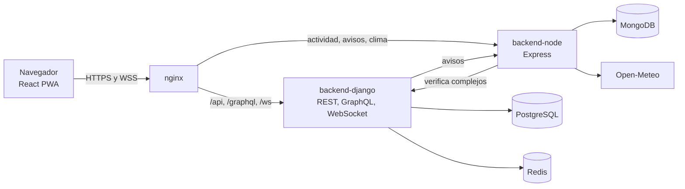

<div align="center">

# TaLibre

**Plataforma web de gestión y reserva de turnos para complejos deportivos**

Disponibilidad en tiempo real · Mapa interactivo · Panel de gestión para complejos · Reportes

[](https://github.com/ValentinRivero/TaLibre/actions/workflows/ci.yml)       

</div>

---

## Contexto académico

| | |
|---|---|
| **Institución** | Universidad Tecnológica Nacional (UTN) · Facultad Regional Resistencia · Extensión Áulica Goya |
| **Proyecto** | Trabajo Final Integrador (TFI) de la carrera, integrado con el Trabajo Práctico Integrador (TPI) de Programación IV |
| **Equipo** | Bombo Devs |
| **Integrantes** | Rivero, Santiago Valentín · Villalva, Nahuel Joaquín |
| **Profesor coordinador** | Sosa, Marco |
| **Profesores de Programación** | Goya, Juan Manuel · Ramírez, Gerardo |

---

## Sobre el proyecto

En Goya, reservar una cancha suele depender de llamadas o mensajes, sin saber de antemano qué horarios están libres. Los complejos, por su parte, gestionan su agenda en papel o en planillas, y les cuesta medir la ocupación y la recaudación.

**TaLibre** conecta a jugadores y complejos deportivos en una sola plataforma:

- **Jugadores:** buscan complejos por deporte, servicios o cercanía en un mapa, ven la grilla de turnos actualizada en tiempo real, reservan, informan la transferencia de la seña y cancelan desde el celular.
- **Complejos:** configuran sus canchas, horarios y precios, cargan reservas telefónicas y turnos fijos, cierran franjas por mantenimiento o clima, concilian señas y consultan reportes de ocupación y recaudación.
- **Plataforma:** administra los contratos de los complejos, los usuarios, los roles y permisos, y la auditoría de seguridad.

## Sistema en funcionamiento

El sistema está desplegado en un servidor propio con HTTPS y despliegue continuo desde `main`. La dirección pública y las credenciales de los usuarios de demostración se entregan en el informe final, para no publicar en un repositorio abierto el acceso como superadministrador.

Para probarlo en una computadora propia, la [Opción A de la guía de instalación](docs/INSTALACION.md#3-opción-a-un-solo-comando-con-docker) levanta todo con un solo comando y usuarios de demostración con una contraseña local.

---

## Arquitectura



Un backend principal en Django concentra el negocio transaccional sobre PostgreSQL: reservas que no pueden solaparse, señas, contratos, permisos y reportes. Publica una API REST, un endpoint GraphQL y un WebSocket que actualiza las grillas abiertas cuando alguien reserva. Un servicio complementario en Node guarda en MongoDB la actividad de los complejos y las notificaciones, y consulta el pronóstico del clima. Cada backend es dueño de su base y se comunican por HTTP. nginx sirve el frontend compilado y reparte las rutas, así el navegador habla con un único origen.

La especificación completa, el modelo de datos de los dos motores, la seguridad, el rendimiento y las 14 decisiones de arquitectura con su justificación están en [docs/ARQUITECTURA.md](docs/ARQUITECTURA.md).

## Stack tecnológico

| Capa | Tecnologías |
|---|---|
| Backend principal | Python 3.14, Django 6.1, Django REST Framework, SimpleJWT, Django Channels con Daphne, graphene-django, drf-spectacular, django-filter, nh3 |
| Servicio complementario | Node.js 24, Express 5, Mongoose 9, Helmet, express-rate-limit, express-validator, swagger-ui-express |
| Frontend | React 19, Vite 8, React Router, Axios, Bootstrap 5, Leaflet |
| Datos | PostgreSQL, MongoDB, Redis |
| Infraestructura | Docker Compose, nginx, GitHub Actions |
| Calidad | pytest con pytest-cov, Jest con Supertest, Vitest, ruff, eslint |

## Estructura del repositorio

| Carpeta | Qué contiene | Por qué está ahí |
|---|---|---|
| `backend-django/` | API principal: modelos, repositorios, servicios, serializers, vistas, GraphQL, WebSocket y sus pruebas | Las reglas que exigen transacciones y bloqueos de fila viven junto a la base relacional |
| `backend-node/` | Rutas, middlewares, controladores, servicios y modelos de Mongoose, con sus pruebas | Los eventos y avisos son de escritura frecuente y estructura flexible, y su caída no afecta las reservas |
| `frontend/` | Páginas, componentes, hooks, servicios, tema, textos y la aplicación instalable | Un cliente que solo conoce los backends a través de su capa de servicios |
| `nginx/` | Configuración del servidor web de producción y del entorno local | Un único origen para el navegador y las rutas internas cerradas |
| `docs/` | Instalación, arquitectura, API, guía de usuario, cobertura y estado del proyecto | Documentación versionada junto al código |
| `.github/` | Integración continua, despliegue continuo y prueba de humo | Cada cambio se verifica y se despliega igual |

## Qué levantar primero

**Opción A, un solo comando (recomendada para probar):** con Docker instalado, desde la raíz del clon:

```bash
docker compose -f docker-compose.local.yml up --build
```

Levanta PostgreSQL, MongoDB, Redis, los dos backends y nginx con el frontend en `http://localhost:8080`, aplica las migraciones y carga los datos de demostración. Los usuarios de cada rol entran con la contraseña local `DemoLocal2026`.

**Opción B, servicio por servicio (para desarrollar):** en este orden, porque cada pieza necesita a la anterior:

1. **Bases de datos:** MongoDB (necesaria para Node), y opcionalmente PostgreSQL y Redis. Sin ellos, Django usa SQLite y memoria.
2. **backend-django:** entorno virtual, `pip install -r requirements.txt`, `.env` con las dos claves obligatorias, `migrate`, `seed_inicial` y `runserver` en el puerto 8000.
3. **backend-node:** `npm ci`, `.env` con MongoDB, la misma clave de firma y la dirección de Django, y `npm run dev` en el puerto 3000.
4. **frontend:** `npm ci` y `npm run dev` en el puerto 5173.

El paso a paso, las variables de cada servicio, qué funciona si falta una pieza y los problemas frecuentes están en [docs/INSTALACION.md](docs/INSTALACION.md).

## Pruebas e integración continua

| Proyecto | Comando | Qué cubre |
|---|---|---|
| backend-django | `pytest --cov=core` | Reglas de negocio, permisos por rol, límites, sanitización, WebSocket, GraphQL, datos personales y configuración de despliegue |
| backend-django | `pytest core/tests/test_concurrencia.py --ds=config.settings_concurrencia` | Reservas simultáneas sobre PostgreSQL real |
| backend-node | `npm run test:cobertura` | Rutas, middlewares, controladores e integraciones simuladas, con umbral de cobertura del 95 % |
| frontend | `npm test` y `npm run build` | Funciones puras, textos y compilación de producción |
| Stack completo | `.github/scripts/prueba_humo.py` | Recorrido de punta a punta a través de nginx: catálogo, GraphQL, documentación, inicio de sesión, reserva con su evento en tiempo real y cancelación |

El workflow de CI corre en cada pull request y en cada push a `main`:

- **django:** ruff, migraciones y pruebas con cobertura.
- **django-concurrencia:** pruebas de concurrencia sobre PostgreSQL.
- **node:** auditoría de dependencias, eslint y pruebas con su umbral.
- **frontend:** auditoría, eslint, pruebas y compilación.
- **stack:** construye las tres imágenes, levanta el entorno local completo y corre la prueba de humo.

`main` está protegida y solo acepta cambios por pull request con el CI en verde. Cada push a `main` aprobado se despliega solo. Las versiones se etiquetan y el rollback a una etiqueta anterior está documentado y probado. Los totales y la cobertura por módulo están en [docs/COBERTURA.md](docs/COBERTURA.md).

## Documentación

| Documento | Contenido |
|---|---|
| [INSTALACION.md](docs/INSTALACION.md) | Puesta en marcha con Docker o servicio por servicio, pruebas, despliegue, versiones y rollback |
| [ARQUITECTURA.md](docs/ARQUITECTURA.md) | Especificación técnica, bases de datos, seguridad, rendimiento y decisiones de arquitectura |
| [API.md](docs/API.md) | Referencia de los endpoints REST, GraphQL, WebSocket y de Node |
| [GUIA_USUARIO.md](docs/GUIA_USUARIO.md) | Recorrido por rol con capturas del sistema |
| [COBERTURA.md](docs/COBERTURA.md) | Pruebas, cobertura y qué verifica cada suite |
| [ESTADO_PROYECTO.md](docs/ESTADO_PROYECTO.md) | Avance por fase e ítem, con las notas de cada etapa |

Con el sistema levantado, las dos APIs publican su documentación interactiva con Swagger UI en `/api/docs-django/` y `/api/docs-node/`.

## Uso de asistentes de inteligencia artificial

Durante el desarrollo se usaron asistentes de inteligencia artificial (Claude y Claude Code de Anthropic, y Gemini de Google) como herramienta de apoyo para planificar las etapas, redactar y revisar código a partir de una especificación escrita por el equipo (reglas de arquitectura, modelo de datos y contratos de la API definidos antes de programar), escribir y ampliar pruebas automatizadas, revisar seguridad y licencias, y redactar documentación.

También se usaron en el diseño de la identidad visual: el logo, los íconos de la aplicación instalable (generados por un script propio del repositorio), la ilustración de la portada y la animación de carga, creados desde cero por el equipo a partir de sus propias ideas y refinados en sucesivas iteraciones.

Las decisiones de arquitectura, el alcance, las reglas de negocio y el diseño las definió el equipo. Todo el código fue revisado, probado e integrado por sus integrantes.

## Código y recursos de terceros

Todas las dependencias tienen licencias abiertas permisivas (MIT, BSD, ISC, Apache-2.0 o PSF). La única excepción es `psycopg2-binary` (LGPL-3.0), el driver de PostgreSQL, que se usa sin modificar como biblioteca enlazada. Las versiones exactas están fijadas en `backend-django/requirements.txt` y en los `package-lock.json`.

| Recurso | Licencia | Uso |
|---|---|---|
| [Bootstrap](https://getbootstrap.com/) y [React Bootstrap](https://react-bootstrap.github.io/) | MIT | Grilla de diseño y componentes accesibles, tematizados con variables propias |
| [Leaflet](https://leafletjs.com/) | BSD-2-Clause | Mapa del catálogo, con un envoltorio propio de React. No se usa `react-leaflet`, cuya licencia no es de código abierto |
| [Barlow Semi Condensed](https://github.com/jpt/barlow) | SIL Open Font License 1.1 | Tipografía de títulos, autoalojada en `frontend/public/fonts/` junto a su `OFL.txt` |
| Esri World Street Map | Términos de uso de Esri | Teselas del mapa, con la atribución `Tiles © Esri` visible en el mapa |
| [OpenStreetMap](https://www.openstreetmap.org/copyright) | ODbL | Datos de las calles del mapa, con la atribución `© OpenStreetMap contributors` visible en el mapa |
| [Open-Meteo](https://open-meteo.com/) | CC BY 4.0 | Pronóstico del clima, con la atribución a Open-Meteo.com junto a cada bloque de clima |

## Recursos visuales propios

Son obra del equipo, creados con asistencia de inteligencia artificial (ver la declaración anterior):

- El logo y los íconos de la aplicación instalable, generados por `frontend/scripts/generar-iconos.mjs`.
- La ilustración de la cancha de la portada, en `frontend/src/components/HeroPresentacion.jsx`.
- La animación de carga, en `frontend/src/assets/loader-pelotas.webp` y `loader-pelotas-quieta.png`.
- Los íconos de la interfaz, trazos SVG propios en `frontend/src/components/Icono.jsx`.

## Flujo de trabajo

- Cada tema se desarrolla en su propia rama (`feat/<tema>`, `fix/<tema>` o `docs/<tema>`) que sale de `main` actualizada.
- Se integra a `main` por pull request, con el CI en verde y revisión manual de ser posible.
- Cada integración a `main` se despliega sola y cada versión entregada lleva su etiqueta (`vX.Y.Z` - EJ: `v0.7.2`).
- Las reglas de arquitectura, estilo, seguridad y datos personales se escribieron antes del código y cada etapa se implementó contra ellas, con sus pruebas en el mismo cambio.

---

<div align="center">

Desarrollado por **Bombo Devs** · UTN FRRe · Extensión Áulica Goya · 2026

</div>
